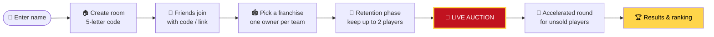
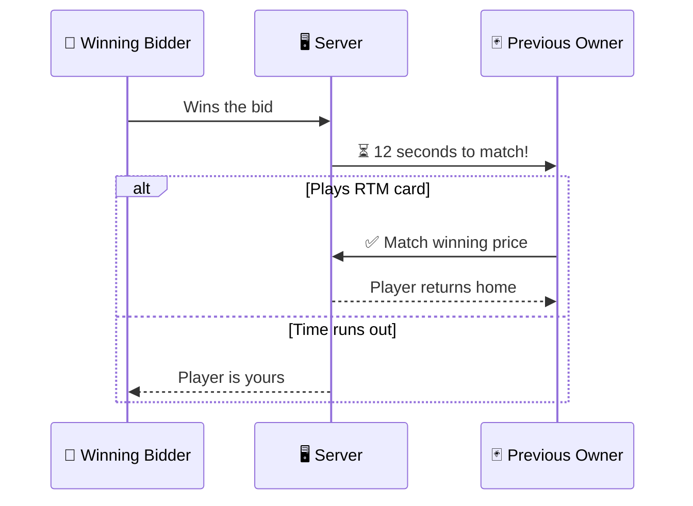

<div align="center">




### 🏏 Your friends. Ten franchises. ₹100 Cr each. One gavel.
**A real-time room-code multiplayer auction game for 7–10 players — no login, no keys, just a name and a code.**


[⚡ Quick Start](#-quick-start) · [🎮 How a Game Goes](#-how-a-game-goes) · [🃏 RTM](#-right-to-match-rtm) · [📜 Rules](#-server-enforced-rules) · [🧱 Structure](#-project-structure) · [🚀 Deploy](#-deploy)

</div>

---

## ✨ Why this feels like the real thing

<table>
<tr>
<td width="62%">

- ⏱️ **Heart-stopping timers** — 15s to open, resets to **10s** on every bid
- 💥 **SNAP bids** — jump **+1 Cr** and scare everyone else off
- 🃏 **Right-to-Match cards** — steal a player back from the winner
- 🔊 **Same look, animations & sounds** as the original `one_more_auction` game
- 🔌 **Rejoin anytime** — refresh the page and your seat is still yours
- 👑 **Host never leaves you stranded** — auto-transfers if the host drops for 20s
- 🏆 **Final ranking** by Team Power Rating

</td>
<td align="center" width="38%">



<sub>*Every. Single. Bid. Resets this.*</sub>

</td>
</tr>
</table>

---

## ⚡ Quick Start

```bash
npm run install:all          # installs server + client
npm run dev:server           # terminal 1 → http://localhost:3000
npm run dev:client           # terminal 2 → http://localhost:5173
```

> 📶 **Friends on the same WiFi?** Share `http://<your-ip>:5173` and they can join instantly.

<details>
<summary><b>🧪 Testing alone? (click to expand)</b></summary>

<br>

Start with fewer players using:

```bash
MIN_PLAYERS=2 npm run dev:server
```

Or let the bots do it for you — `npm test` plays **full 7-player auctions** with bots against the real server.

</details>

<details>
<summary><b>🌐 Production / one-server mode</b></summary>

<br>

```bash
npm run start                # builds React, then serves everything on :3000
```

</details>

---

## 🎮 How a Game Goes



| # | Phase | What happens |
|---|-------|--------------|
| 1️⃣ | **Lobby** | Everyone enters a name. Host taps **Create Auction Room** and gets a 5-letter code (or an invite link). |
| 2️⃣ | **Franchise pick** | Friends **Join Room** with the code. Each picks a franchise — one owner per team. |
| 3️⃣ | **Retention** | Host starts (needs **7–10** players). Each owner keeps up to **2** of last season's players at a price they set — deducted from the **₹100 Cr** purse. Everyone locks in. |
| 4️⃣ | **Auction** | Players come up automatically in sets: **Grade A → B → Batting → Bowling → Fielding**. |
| 5️⃣ | **Accelerated round** | Unsold players return **once**. |
| 6️⃣ | **Results** | Final ranking by **Team Power Rating**. |

> 🔎 **Anytime:** tap a team to peek at its squad. Owners build their **Playing XI** by drag or tap — max **4 overseas**.

---

## 💸 Bid Like a Pro

| Button | Raise | Vibe |
|:------:|:-----:|------|
| `+0.25` | ₹0.25 Cr | Patient. Polite. Predictable. |
| `+0.50` | ₹0.50 Cr | Showing you're serious. |
| **`SNAP +1`** | **₹1 Cr** | 😈 *"I want him. Right now."* |

```text
 ┌──────────────────────────────────────────────┐
 │  ⏱  OPEN TIMER ........ 15s                  │
 │  🔄  AFTER EVERY BID .... resets to 10s        │
 │  🛑  Highest bidder can't re-bid               │
 │  ⚠️  "Someone bid first" = stale bid rejected  │
 └──────────────────────────────────────────────┘
```

---

## 🃏 Right to Match (RTM)

If a player's **previous franchise** has an owner in your room, the drama begins:



Each franchise gets **1 RTM card**. Use it wisely.

---

## 📜 Server-Enforced Rules

> Nobody can cheat — the **server is the referee**, not the browser.

| 💰 Money | 👥 Squad | 🕹️ Flow |
|----------|----------|---------|
| Purse can't go negative | Max **25** players | Highest bidder can't re-bid |
| Stale bids rejected | Max **8** overseas in squad | Players nobody can afford **skip instantly** |
| | Max **4** overseas in XI | Franchises without an owner don't bid |

**🛠️ Host powers:** pause / resume · force-finalize · end auction

**🔌 Resilience:** refresh or reconnect keeps your seat (same device) · host auto-transfers after 20s of silence

---

## 🧱 Project Structure

```text
📦 ipl-auction
 ┣ 📂 server
 ┃ ┣ 📜 index.js          ← sockets (the live wire)
 ┃ ┣ 📜 engine.js         ← ALL the rules live here
 ┃ ┣ 📜 data.js           ← the players
 ┃ ┗ 📂 test
 ┃   ┗ 🤖 simulate.js     ← bot test: full auctions vs. the real server
 ┣ 📂 client
 ┃ ┣ 📂 src
 ┃ ┃ ┣ 📂 components      ← UI
 ┃ ┃ ┣ 📂 hooks
 ┃ ┃ ┃ ┗ 📜 GameContext.jsx   ← socket + state
 ┃ ┃ ┣ 🎨 styles.css      ← your original look
 ┃ ┃ ┗ 🎨 lobby.css       ← the new bits
 ┗ 📂 assets              ← README animations
```

---

## 🚀 Deploy

Works great on **Render** or **Railway**:

| Setting | Value |
|---------|-------|
| **Build** | `npm run install:all && npm run build` |
| **Start** | `npm start --prefix server` |
| **Client hosted separately?** | Build with `VITE_SERVER_URL=https://your-server` |

---

## 🧪 Tested by Bots, Played by Humans

```bash
npm test
```

Full 7-player auctions, bidding bots, real server. If the bots can't break it, your friends will have to try harder. 😄

---

<div align="center">

### 🔨 Going once… going twice…

**Create a room. Send the code. Build your dream XI.**

<sub>Made with ❤️, React, Socket.io and way too much auction-hall adrenaline.</sub>

</div>
